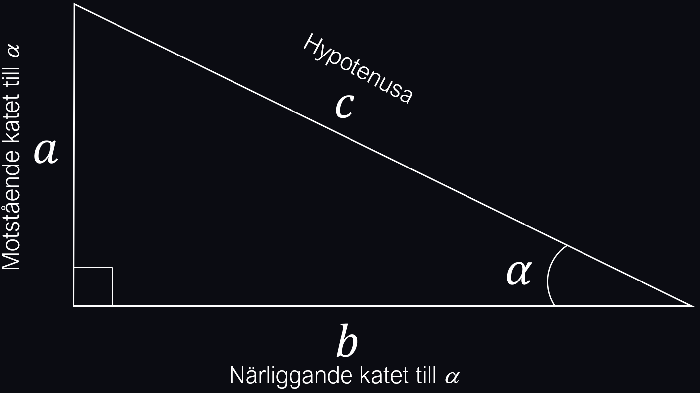

import YouTube from '../../../../components/YouTube.astro';
import GeoGebra from '../../../../components/GeoGebra.astro';
import PhET from '../../../../components/PhET.astro';
import ManimVideo from '../../../../components/ManimVideo.astro';

Här lär du dig det mest grundläggande om trigonometri så att du kan använda det inom geometri, men också tillämpa det inom fysiken tex inom vektorer och vektorkompsanter.
Detta avsnitt lägger grunden för att kunna förjupa sig inom mer trigonometri, såsom enhetscirkeln och trigonometriska funktioner.

## Definitioner av sin, cos & tan
Utifrån bilden nedan definieras i rutan under bilden $\sin(\alpha)$, $\cos(\alpha)$ och $\tan(\alpha)$.
Observera att definitionerna kräver en rätvinklig triangel!

:::note[Definitioner. Lär dig utantill!]
$$
\sin(\alpha)=\frac{\text{motstående katet}}{\text{hypotenusan}}=\frac{a}{c}
$$
$$
\cos(\alpha)=\frac{\text{närliggande katet}}{\text{hypotenusan}}=\frac{b}{c}
$$
$$
\tan(\alpha)=\frac{\text{motstående katet}}{\text{närliggande katet}}=\frac{a}{b}
$$
:::
$\sin(\alpha)$, $\cos(\alpha)$ och $\tan(\alpha)$ är alltså inget annat än förhållandet mellan längderna på olika sidor i en rätvinklig triangel.
Det verkar väl rimligt att dessa förhållanden måste ha något med trianglens vinklar att göra?
Den kopplingen mellan dessa förhallanden och vinkel är just det som $\sin(\alpha)$, $\cos(\alpha)$ och $\tan(\alpha)$ "håller koll på".

## Video - Trigonometrins grunder
I videon nedan definieras begreppen $\sin(\alpha)$, $\cos(\alpha)$ och $\tan(\alpha)$ för en vinkel $\alpha$ i en rätvinklig triangel igen.
Ett antal exempel räknas där man bestämmer både sidor och vinklar i en rätvinklig triangel och hur man använder miniräknarens sin-, cos-, och tan-knappar 

<YouTube id="sUOo4wKrYjM" title="Trigonometrins grunder" />

{/* Interaktiv GeoGebra-figur (ange material-ID från GeoGebra): */}
{/* <GeoGebra id="DITT_GEOGEBRA_ID" height={500} /> */}

{/* Interaktiv PhET-simulering (klistra in länken från PhETs inbäddningskod): */}
{/* <PhET src="https://colorado.edu..." title="PhET-simulering" /> */}

